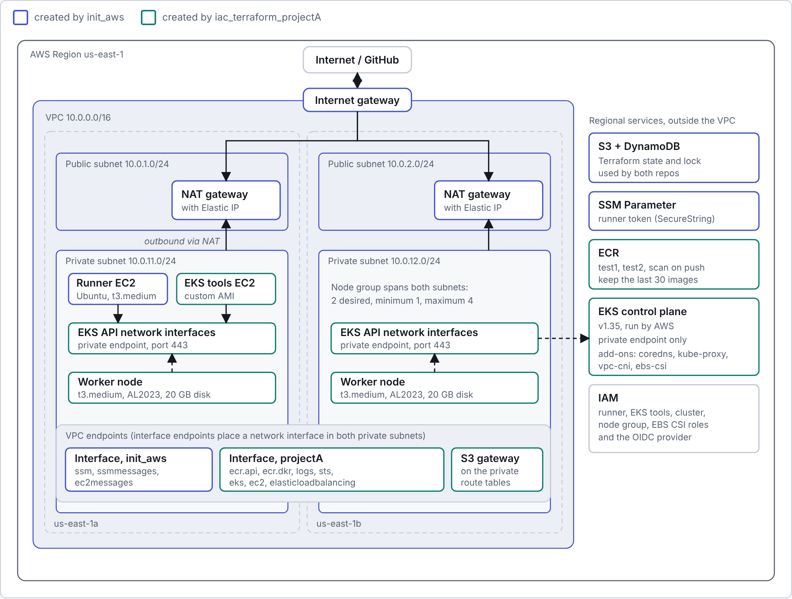
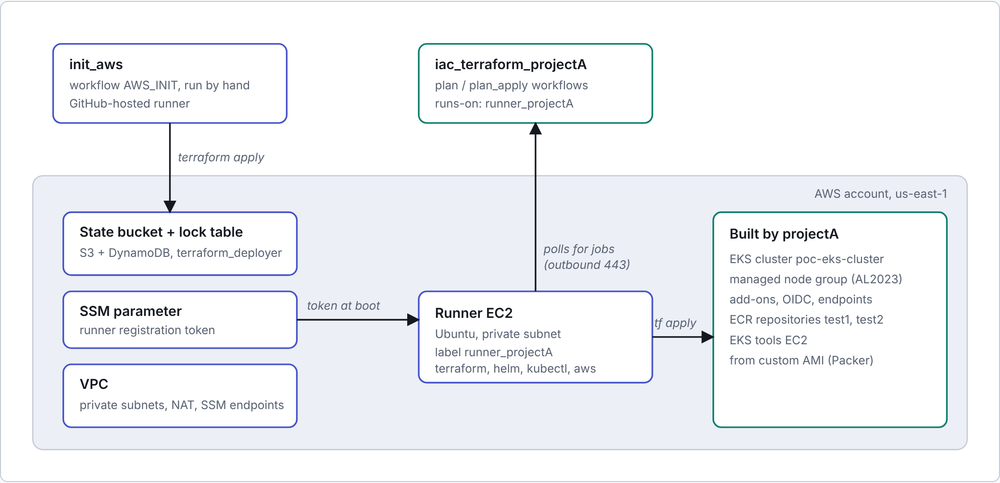
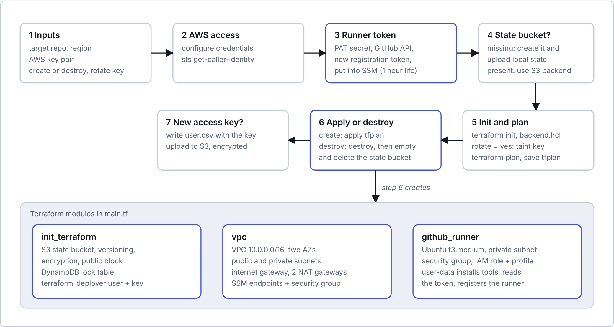
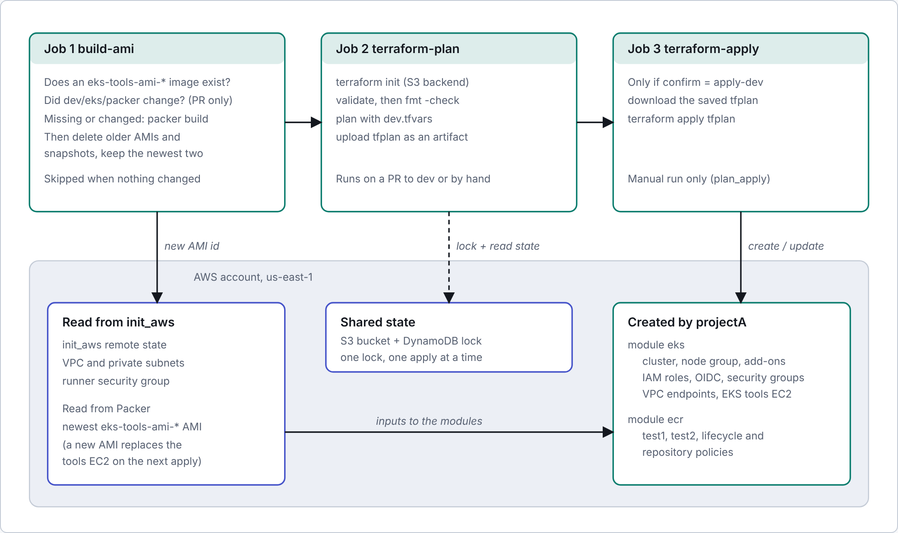

# ProjectA AWS Architecture

Two GitHub repos build one chain. **init_aws** prepares the AWS account and a private self-hosted runner. **iac_terraform_projectA** uses that runner to build the AMI, the EKS cluster and ECR.

created by init_aws created by iac_terraform_projectA

## How the two repos connect

init_aws runs once from a GitHub-hosted runner and creates the left column. The runner it creates then picks up every projectA job from inside the private subnet and applies the right column.

- **Shared state bucket.** projectA stores its state in the bucket and lock table that init_aws created, and reads the init_aws state for the VPC and subnets.
- **Shared runner security group.** init_aws owns the group, projectA adds its own egress rules to it. That is why `sg.tf` in init_aws ignores rule changes.
- **Runner label.** `runner_labels` in init_aws must match `runs-on: runner_projectA` in projectA.

## init_aws: what one run does

The pipeline reads left to right on the top row, then right to left on the second row. Step 3 is the on-the-fly token: no token is copied by hand.

- **Re-running does not re-register the runner.** The instance reads the token only at first boot. A new registration happens only when user-data or its variables change and the instance is replaced.
- **Same name, no duplicate.** The runner name is fixed (`private-runner-poc`) and `--replace` overwrites the old entry.

## iac_terraform_projectA: what a run does

All three jobs run on the private runner. Plan and apply are separate jobs, and apply uses the exact plan file that was reviewed.

- **Packer change detection works on pull requests only.** On a manual plan_apply run a missing AMI is the only build trigger.
- **AMI lookup picks the newest image.** A new AMI changes the tools EC2 on the next plan unless `ami` is added to `ignore_changes`.